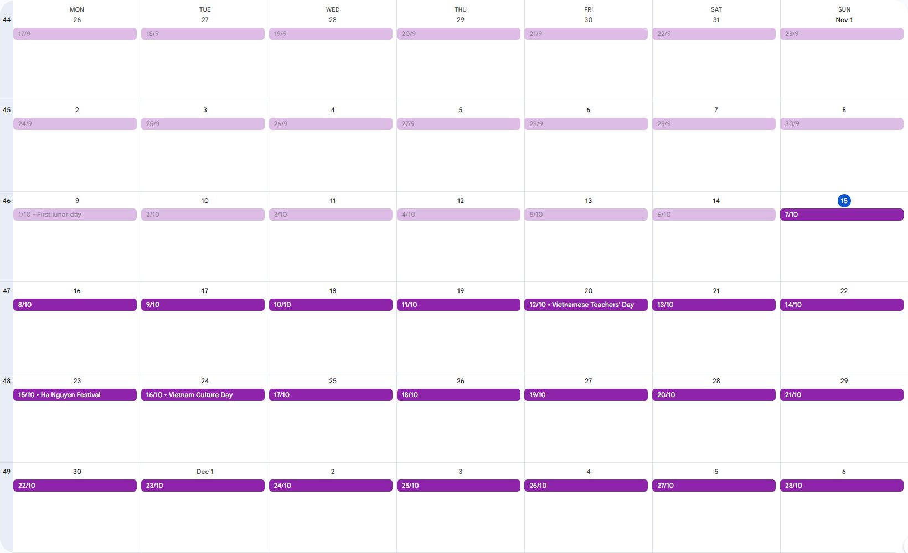

[Tiếng Việt](README.md) · **English**

<h1 align="center">🌙 Vietnamese Lunar Calendar</h1>

<p align="center">
  Vietnamese lunar dates and festivals, synced to your favorite calendar app with one link.
</p>

<p align="center">
  <a href="assets/screenshots/google-calendar-en.png"></a>
  <br /><em>Vietnam Calendar · EN — Google Calendar, November 2026.</em>
</p>

---

## 1. Subscribe quickly by URL

Copy the link below and choose **Add calendar from URL** or **Subscribe to calendar by URL** in your calendar app:

**English — Vietnam Calendar · EN**

```text
https://raw.githubusercontent.com/cmduyeen/lich-am-viet-nam/main/output/viet_lunar_en_latest.ics
```

**Tiếng Việt — Lịch Việt Nam · VI**

```text
https://raw.githubusercontent.com/cmduyeen/lich-am-viet-nam/main/output/viet_lunar_latest.ics
```

Paste the link and save. Subscribe by URL to receive updates automatically. Compatible with Google Calendar, Apple Calendar, Outlook, and other apps that support iCalendar.

Choose one language. For example: `15/8 • Mid-Autumn Festival` or `15/8 • Tết Trung Thu`. The existing Vietnamese subscription URL is unchanged.

### One calendar for everything

- **Every daily lunar date**, with lunar and Gregorian holidays in the same event.
- The first and fifteenth days of each lunar month, and Lunar New Year's Eve.
- Major holidays: New Year's Day, Tết (Vietnamese Lunar New Year), Hùng Kings' Commemoration Day, Reunification Day, International Workers' Day, and National Day.
- Traditional observances: Kitchen Gods Day, God of Wealth Day, First Full Moon Festival, Han Thuc, Buddha's Birthday, Doan Ngo, Vu Lan, Mid-Autumn and Ha Nguyen.
- Gregorian observances: Valentine's Day, International Women's Day, Children's Day, Vietnamese Family Day, Vietnamese Women's Day, Vietnamese Teachers' Day, Vietnam Culture Day (from 2026), Christmas Eve and Christmas.

For example: `12/10 • Vietnamese Teachers' Day`. Holidays sharing a date remain in **one** event. [Catalog and sources](docs/HOLIDAYS.md). This is a calendar of festivals and observances; compensatory leave and workday swaps depend on annual announcements.

Dates follow Vietnam time (GMT+7). The calendar refreshes automatically at 07:17 Vietnam time on the first day of each month, covering the current year and the next ten years. Leap months are labeled, and annual lunar festivals occur in regular months.


## 2. Create a custom calendar with Python

Use Python 3.11 or later. Download the source and install dependencies:

```sh
git clone https://github.com/cmduyeen/lich-am-viet-nam.git
cd lich-am-viet-nam
python -m pip install -r requirements.txt
```

**Choose a language**, with all holidays included by default:

```sh
python main.py --language en
python main.py --language vi
```

**Choose which holidays** to annotate, for example Lunar New Year and Mid-Autumn Festival:

```sh
python main.py --language en --holidays tet-1,tet-2,tet-3,mid-autumn
```

Change `en` to `vi` for Vietnamese. Use `--holidays none` for lunar dates and first/fifteenth lunar day labels only. Every selection still includes **every day**.

<details>
<summary>Holiday IDs and personal dates</summary>

List all available holiday IDs:

```sh
python main.py --list-holidays --language en
```

| ID | Holiday |
| --- | --- |
| `tet-1`, `tet-2`, `tet-3` | Lunar New Year, days 1–3 |
| `new-year-eve` | Lunar New Year's Eve |
| `god-of-wealth` | God of Wealth Day |
| `first-full-moon` | First Full Moon Festival |
| `hung-kings` | Hung Kings' Commemoration Day |
| `buddha-birthday` | Buddha's Birthday |
| `doan-ngo` | Doan Ngo Festival |
| `vu-lan` | Vu Lan Festival |
| `mid-autumn` | Mid-Autumn Festival |
| `kitchen-gods` | Kitchen Gods Day |
| `new-year` | New Year's Day |
| `reunification` | Reunification Day |
| `labour-day` | International Workers' Day |
| `national-day` | National Day |
| `valentine` | Valentine's Day |
| `international-women` | International Women's Day |
| `children` | Children's Day |
| `family` | Vietnamese Family Day |
| `vietnamese-women` | Vietnamese Women's Day |
| `teachers` | Vietnamese Teachers' Day |
| `culture` | Vietnam Culture Day (from 2026) |
| `christmas-eve`, `christmas` | Christmas Eve, Christmas |
| `han-thuc`, `ha-nguyen` | Han Thuc, Ha Nguyen |

Copy [examples/holidays.json](examples/holidays.json) to `.local/holidays.json` and edit that private copy to add memorial dates, birthdays, or anniversaries. Each entry has a `calendar` of `lunar` or `solar`, a `month`, a `day`, and names in both `vi` and `en`:

```json
[
  {
    "calendar": "lunar",
    "month": 3,
    "day": 12,
    "name": {"vi": "Ngày giỗ gia đình", "en": "Family memorial day"}
  }
]
```

```sh
python main.py --language en --holidays tet-1,mid-autumn --custom-holidays .local/holidays.json
```

Personal dates are added to the selected holidays. Lunar holidays occur only in regular months; day 30 appears only in months with 30 days, and February 29 only in leap years. Holidays sharing a date appear together in **one** event.

</details>

Standard calendars are saved in `output/`: `viet_lunar_en_latest.ics` (English) or `viet_lunar_latest.ics` (Vietnamese) by default. Selecting holidays or adding personal dates writes to `.local/output/` (ignored by Git), producing `viet_lunar_custom_en_latest.ics` or `viet_lunar_custom_vi_latest.ics`, separate from the quick subscription feeds.

Add `--year 2027` for a single year, `--start 2026 --end 2036` for a range, `--split` for yearly files and a ZIP, or `--output-dir my-calendar` to choose a folder. With `--year`, the filename contains the year instead of `latest`.

Import the generated `.ics` file into your calendar app. To subscribe to a custom calendar by URL, host the file at a fixed public URL and rerun Python when you want to update it. The quick subscription feeds above are updated automatically each month by this repository. Personal dates in a publicly hosted calendar are readable by anyone; keep private calendars in `.local/` when you do not want to publish them.

[Operations and maintenance](docs/OPERATIONS.md#english) · [Privacy and security](SECURITY.md)

---

<p align="center">
  Open-source software under the <a href="LICENSE">MIT</a> license.
</p>
