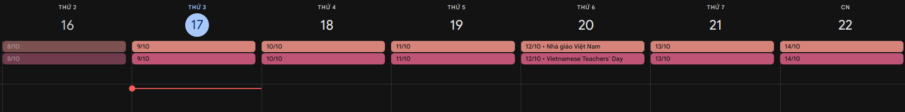

# 🌙 Vietnamese Lunar Calendar

[Tiếng Việt](README.md) · [English](README.en.md)



Vietnamese lunar dates in GMT+7, displayed in **Vietnamese or English**. Each civil day has one event containing its lunar date and relevant observances. Both feeds use the same dates; only the display language changes.

## Subscribe

**Vietnamese**

```text
https://raw.githubusercontent.com/cmduyeen/lich-am-viet-nam/main/output/viet_lunar_latest.ics
```

**English**

```text
https://raw.githubusercontent.com/cmduyeen/lich-am-viet-nam/main/output/viet_lunar_en_latest.ics
```

Paste one URL into **Add calendar from URL / Subscribe** in Google Calendar, Apple Calendar or Outlook. Choose one language to avoid seeing both sets of events. Importing an ICS file creates a snapshot and does not follow URL updates.

### Add to Google Calendar in 4 steps

1. Copy the **Vietnamese or English** feed URL above.
2. Open [Google Calendar](https://calendar.google.com/) in a desktop browser.
3. Next to **Other calendars**, click **+ → From URL**.
4. Paste the URL and click **Add calendar**. Find it under **Other calendars**.


**Google Calendar screen recording**

https://github.com/user-attachments/assets/37bef49a-dff3-42a1-b842-bd1d1a16d44e

Subscribe on your computer first, then use the Google Calendar app with the same account on your phone. See [Google's instructions](https://support.google.com/calendar/answer/37100?hl=en).

Default coverage is the current year and next year. Your calendar app controls its refresh interval. Repository changes reach subscription URLs after publication to `main`.

## Generate with Python

Requires Python 3.11 or later:

```powershell
python -m pip install --require-hashes -r requirements.txt
python generate_all.py
```

This publishes exactly two Vietnamese/English feeds into `output/`. Skip generation when inputs and output checksums are unchanged:

```powershell
python generate_all.py --if-needed
```

Generate a single language or save annual snapshots:

```powershell
python main.py --language vi
python main.py --language en
python main.py --language vi --split --output-dir exports
```

## Select holidays and add personal dates

```powershell
python main.py --language en --list-holidays
python main.py --language en --holidays mid-autumn
python main.py --language vi --custom-holidays .local/holidays.json
```

Use the [fictional JSON example](examples/holidays.json) for personal dates. Customized calendars default to ignored `.local/output/`. Keep private data out of the public repository.

Observances are not substitute-day or statutory leave schedules. See the [holiday catalog](docs/HOLIDAYS.md).

## Maintenance

GitHub Actions tests before publication and runs annually and on source changes. Unchanged scheduled runs skip generation and data commits. See [automation](docs/AUTOMATION.md), [operations](docs/OPERATIONS.md), [release checks](docs/RELEASE.md) and [security](SECURITY.md).

[MIT](LICENSE) · [cmduyeen](https://github.com/cmduyeen)
