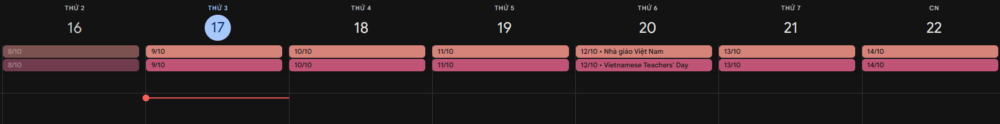
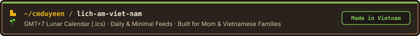
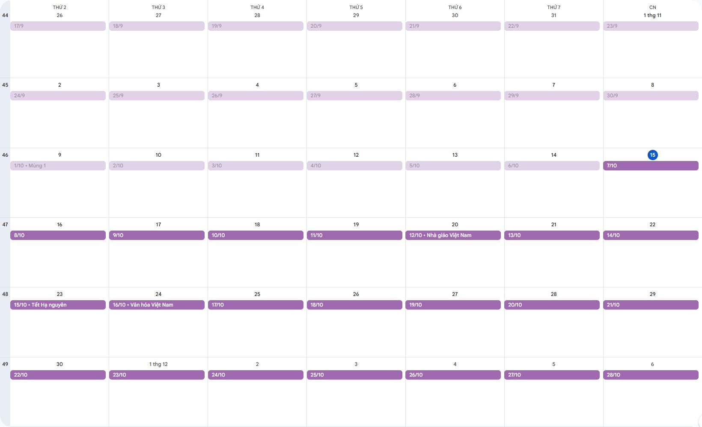

# 🌙 Lịch Âm Việt Nam (Google Calendar, Apple Calendar, Outlook)

[Tiếng Việt](README.md) · [English](README.en.md)

[](https://github.com/cmduyeen/lich-am-viet-nam/actions/workflows/main.yml)
[](https://www.python.org/downloads/)
[](LICENSE)
[](https://ko-fi.com/cmduyeen)



[](https://cmduyeen.github.io/lich-am-viet-nam/)

**Lịch âm Việt Nam miễn phí (.ics)** theo múi giờ chuẩn Việt Nam (**GMT+7 / UTC+7**), hỗ trợ song ngữ **tiếng Việt và tiếng Anh**. **Không cần cài thêm app hay phần mềm bên thứ ba** — bạn có thể dùng **[Web Studio tùy chỉnh lịch trực tuyến](https://cmduyeen.github.io/lich-am-viet-nam/)** (thêm ngày giỗ, sinh nhật âm lịch, chọn ngày Mùng 1/Rằm, tra cứu Âm ↔ Dương và xuất `.ics` ngay trên trình duyệt) hoặc sao chép **1 đường link `.ics`** dán vào **Google Calendar, Apple Calendar, Outlook** để tự động cập nhật hằng năm.

> 🌐 **Dùng ngay trên trình duyệt:** **[cmduyeen.github.io/lich-am-viet-nam](https://cmduyeen.github.io/lich-am-viet-nam/)** · Khám phá thêm tại **[Blog & Tools](https://cmduyeen.github.io/tools/)** · ☕ **[Mời mình 1 ly cà phê](https://ko-fi.com/cmduyeen)**

## Mục lục

- [Tùy chỉnh lịch âm trực tuyến (Web Studio)](#tùy-chỉnh-lịch-âm-trực-tuyến-web-studio)
- [Đăng ký lịch âm qua URL (Không cần cài app — Gắn link dùng luôn)](#đăng-ký-lịch-âm-qua-url-không-cần-cài-app--gắn-link-dùng-luôn)
- [Hướng dẫn cài đặt nhanh](#hướng-dẫn-cài-đặt-nhanh)
- [Điểm nổi bật](#điểm-nổi-bật)
- [Tự tạo lịch & Thêm ngày riêng bằng Python (Tùy chọn cho lập trình viên)](#tự-tạo-lịch--thêm-ngày-riêng-bằng-python-tùy-chọn-cho-lập-trình-viên)
- [Vận hành & Tự động hóa](#vận-hành--tự-động-hóa)
- [Câu hỏi thường gặp (FAQ)](#câu-hỏi-thường-gặp-faq)

## Tùy chỉnh lịch âm trực tuyến (Web Studio)

Truy cập **[Lịch Âm Việt Nam Studio](https://cmduyeen.github.io/lich-am-viet-nam/)** để cá nhân hóa lịch âm ngay trên trình duyệt mà không cần cài Python:

- **Chọn mức độ hiển thị:** Chỉ ngày lễ lớn, Ngày lễ + Mùng 1 & Rằm, hoặc đầy đủ tất cả các ngày âm lịch.
- **Thêm ngày riêng của bạn:** Thêm ngày giỗ, sinh nhật âm lịch, kỷ niệm cá nhân lặp lại hằng năm.
- **Tra cứu nhanh Dương ↔ Âm:** Kiểm tra ngày âm lịch & Can Chi bất kỳ theo múi giờ chuẩn GMT+7.
- **Xuất file `.ics` hoặc JSON/CLI:** Tải file `.ics` dùng ngay hoặc copy cấu hình cho Python CLI.

## Đăng ký lịch âm qua URL (Không cần cài app — Gắn link dùng luôn)

Bạn **không cần tải file, không cần cài Python hay ứng dụng lịch bên thứ ba**. Chỉ cần sao chép **một** đường dẫn `.ics` phù hợp dưới đây và dán vào ứng dụng lịch mặc định trên máy (tất cả đều dùng chung dữ liệu ngày âm lịch chuẩn GMT+7):

**Đầy đủ hằng ngày (365 ngày âm lịch + ngày lễ)**

* Tiếng Việt:
```text
https://raw.githubusercontent.com/cmduyeen/lich-am-viet-nam/main/output/viet_lunar_latest.ics
```
* Tiếng Anh (English):
```text
https://raw.githubusercontent.com/cmduyeen/lich-am-viet-nam/main/output/viet_lunar_en_latest.ics
```

**Tối giản (Chỉ ngày lễ Âm/Dương lịch, Tết, Mùng 1 & Rằm)**

* Tiếng Việt:
```text
https://raw.githubusercontent.com/cmduyeen/lich-am-viet-nam/main/output/viet_lunar_minimal_latest.ics
```
* Tiếng Anh (English):
```text
https://raw.githubusercontent.com/cmduyeen/lich-am-viet-nam/main/output/viet_lunar_en_minimal_latest.ics
```

> **Lưu ý:** Chỉ nên đăng ký **một ngôn ngữ** để tránh hiển thị trùng hai sự kiện mỗi ngày. Hãy dùng tính năng **Thêm lịch từ URL / Đăng ký lịch (Subscribe)** thay vì tải tệp `.ics` về nhập thủ công, vì nhập tệp tĩnh sẽ không tự cập nhật khi sang năm mới.

## Hướng dẫn cài đặt nhanh

### 1. Google Calendar (Android, iPhone, Web)

1. Sao chép link `.ics` **tiếng Việt hoặc tiếng Anh** ở trên.
2. Mở [Google Calendar](https://calendar.google.com/) trên trình duyệt máy tính.
3. Ở cột bên trái, cạnh mục **Lịch khác (Other calendars)**, nhấn **+ → Từ URL (From URL)**.
4. Dán link và nhấn **Thêm lịch (Add calendar)**. Lịch sẽ tự đồng bộ sang ứng dụng Google Calendar trên điện thoại khi dùng cùng tài khoản.



**Video thao tác trực tiếp trên Google Calendar:**

https://github.com/user-attachments/assets/77db24f7-752b-4ab0-9a5d-4c3d2b17af45

Xem thêm [hướng dẫn chính thức của Google](https://support.google.com/calendar/answer/37100?hl=vi).

### 2. Apple Calendar (iPhone, iPad, Mac)

- **Trên iPhone / iPad:** Mở ứng dụng **Lịch (Calendar)** → nhấn **Lịch (Calendars)** ở dưới cùng → **Thêm lịch (Add Calendar)** → **Thêm lịch đã đăng ký (Add Subscription Calendar)** → dán URL `.ics` và nhấn **Đăng ký (Subscribe)**.
- **Trên macOS:** Mở **Calendar** → chọn **File → New Calendar Subscription...** → dán URL `.ics` → nhấn **Subscribe**.

### 3. Microsoft Outlook

- Mở [Outlook trên web](https://outlook.live.com/calendar/) → chọn **Add calendar (Thêm lịch)** → **Subscribe from web (Đăng ký từ web)** → dán URL `.ics`, đặt tên lịch và nhấn **Import**.

## Điểm nổi bật

- **Không cần cài phần mềm ngoài:** Chỉ cần dán 1 link `.ics` vào Google Calendar, Apple Calendar hoặc Outlook có sẵn trên điện thoại/máy tính là dùng ngay, không lo app nặng máy hay quảng cáo.
- **Chuẩn thiên văn Việt Nam (GMT+7):** Tính toán trực tiếp từ điểm Sóc (New Moon) và Tiết khí theo múi giờ UTC+7, đảm bảo chính xác ngày mùng 1, ngày rằm, Tết Nguyên Đán và tháng nhuận theo lịch Việt Nam (tránh lệch ngày khi dùng lịch Trung Quốc múi giờ UTC+8).
- **Phủ 2 năm cuốn chiếu, không đổi URL:** Feed công khai luôn chứa dữ liệu của **năm hiện tại và năm kế tiếp**, tự động cuốn chiếu khi bước sang năm mới mà không cần cài lại link. Bộ máy hỗ trợ tính toán giai đoạn **1900–2099**.
- **27 dịp lễ âm – dương phổ biến:** Bao gồm Tết Nguyên Đán, Giỗ Tổ Hùng Vương, Phật Đản, Vu Lan, Trung Thu, Ông Công Ông Táo, cùng các ngày lễ dương lịch tại Việt Nam. Xem chi tiết tại [danh mục ngày lễ](docs/HOLIDAYS.md).
- **Tối giản & Riêng tư:** Mỗi ngày chỉ 1 sự kiện cả ngày (all-day event), không spam thông báo, không quảng cáo, mã nguồn mở giấy phép MIT.

## Tự tạo lịch & Thêm ngày riêng bằng Python (Tùy chọn cho lập trình viên)

> Người dùng phổ thông **không cần** chạy các lệnh dưới đây — chỉ cần gắn link `.ics` ở mục trên là đủ.

Nếu muốn tự chạy mã nguồn bằng **Python 3.11+** để tạo lịch theo nhu cầu cá nhân (như thêm ngày giỗ, sinh nhật âm lịch hoặc xuất riêng từng năm):

```powershell
python -m pip install --require-hashes -r requirements.txt
python generate_all.py
```

Lệnh trên tạo đúng hai feed Việt–Anh trong `output/`. Để bỏ qua khi dữ liệu không đổi:

```powershell
python generate_all.py --if-needed
```

Tạo một ngôn ngữ hoặc xuất bản chụp từng năm (ví dụ giai đoạn 1900–2099):

```powershell
python main.py --language vi
python main.py --language en
python main.py --language vi --split --output-dir exports
```

### Chọn ngày lễ & Thêm ngày kỷ niệm cá nhân

```powershell
python main.py --language vi --list-holidays
python main.py --language en --holidays mid-autumn
python main.py --language vi --custom-holidays .local/holidays.json
```

Soạn tệp ngày riêng theo [mẫu JSON](examples/holidays.json). Lịch tùy chỉnh mặc định được lưu trong `.local/output/` (được Git bỏ qua để tránh đưa dữ liệu cá nhân lên repo công khai).

> **Lưu ý:** Danh mục ngày lễ là dịp kỷ niệm truyền thống và phổ biến, không phải lịch nghỉ bù hay bảng tính ngày nghỉ hưởng lương theo thông báo hằng năm. Xem [danh mục ngày lễ](docs/HOLIDAYS.md).

## Vận hành & Tự động hóa

- **Tự động cập nhật hằng ngày:** GitHub Actions tự động kiểm tra và chỉ tái xuất lịch khi dữ liệu hoặc mã nguồn thay đổi.
- **Giữ nguyên link vĩnh viễn:** Khi bước sang năm mới, phạm vi tự động cuốn chiếu sang năm hiện tại và năm kế tiếp mà không làm thay đổi URL đăng ký.
- **Tài liệu kỹ thuật:** Xem thêm hướng dẫn [tự động hóa bảo trì](docs/AUTOMATION.md), [vận hành](docs/OPERATIONS.md) và [kiểm tra phát hành](docs/RELEASE.md).

## Câu hỏi thường gặp (FAQ)

**1. Lịch âm có tự cập nhật trên điện thoại không?**  
Có, nếu bạn thêm bằng tính năng **Đăng ký lịch từ URL**. Tần suất làm mới (thường vài giờ đến 24 giờ) do ứng dụng Google Calendar, Apple Calendar hoặc Outlook quyết định.

**2. Tại sao lịch âm Việt Nam đôi khi khác lịch âm Trung Quốc?**  
Do chênh lệch múi giờ giữa Việt Nam (**UTC+7**) và Trung Quốc (**UTC+8**). Nếu điểm Sóc rơi vào khoảng 23:00–23:59 giờ Việt Nam (tức 00:00–00:59 ngày hôm sau tại Trung Quốc), ngày mùng 1 và các ngày lễ âm lịch sẽ lệch nhau 1 ngày. Dự án này tính trực tiếp theo **UTC+7**.

**3. Lịch có hiển thị ngày nghỉ bù lễ Tết không?**  
Không. Lịch hiển thị các ngày âm lịch và 27 dịp lễ/kỷ niệm chuẩn. Lịch nghỉ bù hoặc hoán đổi ngày làm việc phụ thuộc thông báo hằng năm của cơ quan nhà nước.

**4. Tôi muốn đóng góp hoặc báo lỗi thì làm thế nào?**  
Hãy mở [Issue](https://github.com/cmduyeen/lich-am-viet-nam/issues) hoặc gửi Pull Request. Nếu thấy hữu ích, đừng quên tặng repo một **Star ⭐** nhé!

## Đóng góp (Contributors)

- [@cmduyeen](https://github.com/cmduyeen) — Khởi tạo & phát triển dự án
- [@DevSecNinja](https://github.com/DevSecNinja) — Đề xuất và góp ý hoàn thiện bản tiếng Anh & feed tối giản

## Ủng hộ dự án ☕

Dự án hoàn toàn miễn phí và mã nguồn mở. Nếu lịch âm giúp ích cho bạn và gia đình, bạn có thể mời mình một ly cà phê tại **[Ko-fi (ko-fi.com/cmduyeen)](https://ko-fi.com/cmduyeen)** để tiếp thêm động lực duy trì nhé!

---

[MIT License](LICENSE) · Phát triển bởi [cmduyeen](https://github.com/cmduyeen)
