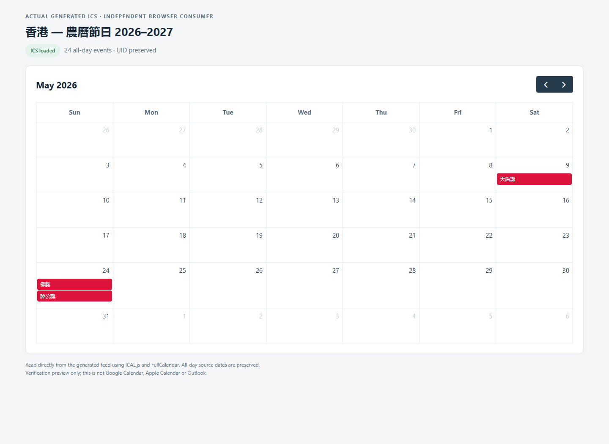
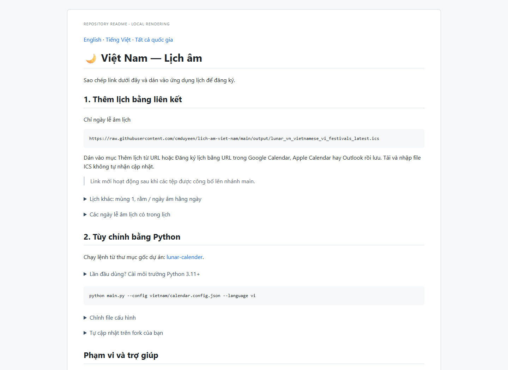

# Verified artifact evidence

Tested on 2026-11-14 (Asia/Ho_Chi_Minh). Screenshots are native headless Edge captures of the actual READMEs and generated ICS rendered by a local ICAL.js/FullCalendar consumer. No mouse pointer, desktop overlay or invented event data is included. The preview is development-only and is not deployed as a website.

- [Machine-readable consumer checks](results.json)
- [Measured repeated-build checks](automation-results.json)
- [Country selector](01-country-selector.png)
- [Vietnam native guide](02-vietnam-guide.png)
- [Malaysia native guide](03-malaysia-guide.png)
- [Vietnam mobile guide](04-vietnam-mobile.png)
- [Hong Kong calendar: both festivals retained on May 24](05-hong-kong-calendar.png)
- [Korean calendar: Chuseok September 24–26](06-korea-calendar.png)
- [Custom subscription after CLI update](07-custom-subscription.png)

This evidence verifies the tested local browser consumer. Google Calendar, Apple Calendar and Outlook subscription/refresh behavior are not claimed. Reproduce using the [test instructions](../../tests/e2e/README.md).
